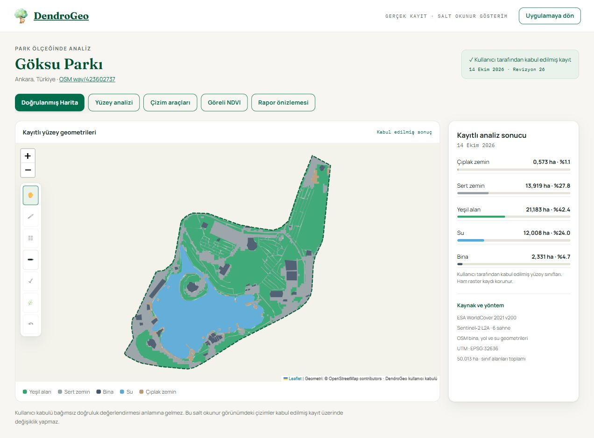
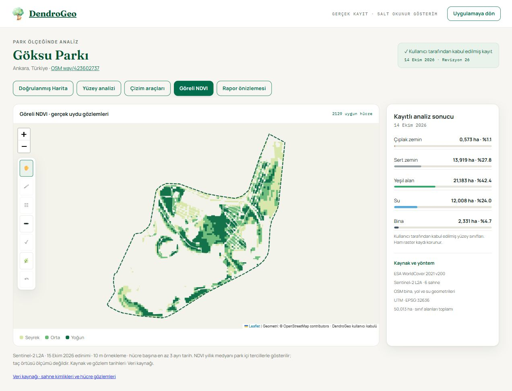

<div align="center">


# DendroGeo

### Ağaç envanteri · Allometrik karbon değerlendirmesi · Kent parkı analizi

Sahadan haritaya, kayıtlı analizden izlenebilir araştırma çıktısına.

[**Platformu açın ↗**](https://dendrogeo.org/) · [**Gerçek park örneği**](https://dendrogeo.org/ornekler/goksu-parki/) · [**Yöntem**](https://dendrogeo.org/yontem/) · [**Rapor arşivi**](https://dendrogeo.org/rapor/)

[](https://github.com/snansrin/dendrogeo/releases)
[](https://doi.org/10.5281/zenodo.22948773)
[](LICENSE)
[](LICENSE-DATA)
[](https://github.com/snansrin/dendrogeo/actions/workflows/ci.yml)
[](https://github.com/snansrin/dendrogeo/actions/workflows/gis-three-park-qa.yml)
[](https://github.com/snansrin/dendrogeo/actions/workflows/research-clients.yml)

</div>

DendroGeo; GPS konumlu saha ağaç ölçümlerini, biyokütle ve karbon tahminlerini, park sınırlarını, arazi örtüsü kanıtlarını ve araştırma raporlarını ortak bir **web GIS / PWA** çalışma alanında yönetir. Peyzaj mimarlığı, kent ormancılığı ve kent parklarının karbon depolama performansı üzerine çalışan araştırmacılar için geliştirilmiştir.

<p align="center"><em>A web GIS workspace for field tree inventories, allometric carbon estimates and reproducible urban park analysis.</em></p>

<table>
<tr>
<td width="50%"><a href="https://dendrogeo.org/ornekler/goksu-parki/"></a></td>
<td width="50%"><a href="https://dendrogeo.org/ornekler/goksu-parki/?view=ndvi"></a></td>
</tr>
<tr><td><strong>Kayıtlı park haritası</strong><br>Park sınırı ve kabul edilmiş yüzey geometrileri.</td><td><strong>Göreli NDVI</strong><br>Gerçek uydu gözlemlerinin aynı park içindeki göreli dağılımı.</td></tr>
</table>

Görseller Göksu Parkı örneğidir; kaynaklar ve tarihler kendi kapsamıyla sunulur. Etkileşimli sınıf, yakınlaştırma ve NDVI kontrolleri için görsellere dokunun.

## Çalışma alanları

| Alan | DendroGeo ile yapılan işlem | Çıktı / belge |
|---|---|---|
| **Saha envanteri** | Konum, tür/grup, göğüs çevresi, boy ve isteğe bağlı fotoğraf; çevrimdışı kuyruk ve senkronizasyon | [Ağaç envanteri](https://dendrogeo.org/agac-envanteri/) |
| **Allometri ve karbon** | Çevreden DBH türetme; kayıtlı tür veya grup yoğunluğuyla biyokütle ve karbon tahmini | [Hesaplama yöntemi](https://dendrogeo.org/karbon-hesaplama/) |
| **Park ve yüzey analizi** | OSM park sınırı; WorldCover rasterı, kullanılabilir spektral kanıt ve OSM geometrileri; beş son yüzey sınıfı | [Arazi örtüsü](https://dendrogeo.org/arazi-ortusu/) |
| **Harita düzenleme** | Hücre kararı, yüzey fırçası, nesne/sınır düzenleme ve şekil çizimi; kabul edilen sonucu kaydetme | [Park örneği](https://dendrogeo.org/ornekler/goksu-parki/) |
| **Saha planı** | Yeşil alanla sınırlı veya parkın tamamında grid; ölçüm noktaları ve saha navigasyonu | [Veri ve dışa aktarım](https://dendrogeo.org/veri/) |
| **Projeler** | Park bağlamında kişisel/ortak projeler, üyelik ve ölçüm yönetimi | Platformun Projeler sekmesi |
| **Raporlama** | DGR kimliği, dondurulmuş dosyalar, SHA-256, kalıcı bağlantı ve ayrı DOI kaydı | [Yayın arşivi](https://dendrogeo.org/rapor/) |

Son yüzey sonucu **Yeşil alan, Sert zemin, Bina, Su ve Çıplak zemin** sınıflarıyla ifade edilir. Ham yıllık raster, kabul edilmiş yüzey kaydı ve saha ağaç envanteri ayrı kanıt katmanlarıdır.

<details>
<summary><strong>Ölçüm ve karbon hesabını inceleyin</strong></summary>

Ham saha ölçümü, yerden **1,30 m** yükseklikte ölçülen göğüs çevresidir. DBH `D = C / π` ile türetilir. Arayüzde 1 ondalık basamak gösterilir; hesap tam hassasiyetle yapılır.

```text
AGB (kg) = 0.0673 × (ρ × D² × H)^0.976
Kök biyokütlesi = AGB × 0.26
Karbon (kg C) = (AGB + kök biyokütlesi) × 0.47
```

`D`: DBH (cm) · `H`: boy (m) · `ρ`: odun yoğunluğu (g/cm³).

Tür/yoğunluk kataloğu ve katsayılar çekirdek kilidiyle korunur. Grup varsayımları ibreli için **446**, yapraklı için **541 kg/m³** değerleridir; `ρ` hesapta g/cm³ birimine dönüştürülür. Çıktı karbon stoğu tahminidir. Kök ve karbon katsayıları sistem varsayımlarıdır; yerel kent ağaçlarında bağımsız doğrulama gerekir.

[Ölçüm protokolü ve yöntem](docs/methods.md) · [Yoğunluk kaynağı](src/config/wood-density-lock.js) · [Bağımsız referans hesabı](research/carbon/README.md)

</details>

<details>
<summary><strong>Yüzey analizi ve göreli NDVI nasıl yorumlanır?</strong></summary>

- **ESA WorldCover 2021 v200:** 10 m kategorik yıllık raster; alan hesabı kaynak hücresi ile park poligonunun gerçek kesişimine dayanır.
- **IO LULC 2020:** çalıştırıldığında bağımsız kaynak karşılaştırması sağlar; her analizde kullanıldığı varsayılmaz.
- **Sentinel-2 L2A:** kullanılabilir gözlemler üzerinden spektral kanıt ve göreli NDVI. Tarih ve kapsam analiz kaydına bağlıdır.
- **OSM ve kullanıcı kararları:** kabul edilen son yüzey geometrisine katılabilir; ham raster ayrı tutulur.
- **Göreli NDVI:** aynı park içindeki dağılıma göre seyrek/orta/yoğun görünüm. Tek başına ağaç sayısı, taç alanı, bitki sağlığı veya doğrudan karbon ölçümü değildir.

[Arazi örtüsü yöntemi](docs/LULC_METHODOLOGY.md) · [Genel bilimsel yöntem](docs/methods.md)

</details>

## v3.0.1

Modüler mimari, yüzey düzenleme ve kayıtlı harita akışları; mobil araçlar, grid/ölçüm noktaları, giriş/çıkış ve yayınlama düzeltmeleri bu sürümde birlikte arşivlenir. Yakın zoom’da bulunmayan uydu karoları kullanılabilir üst seviyeden doğru konuma yerleştirilir. Koyu/açık tema ve Türkçe/İngilizce arayüz iyileştirmeleri de dahildir.

[**Değişiklik günlüğü**](CHANGELOG.md) · [**Ayrıntılı sürüm kapsamı ve commit listesi**](docs/releases/v3.0.1.md) · [**GitHub Release**](https://github.com/snansrin/dendrogeo/releases/tag/v3.0.1)

## Tekrar üretilebilirlik ve atıf

ŞİRİN, N. & ŞİRİN, S. (2026). *DendroGeo: Küresel Ağaç Envanteri ve Karbon Veri Sistemi* (Version 3.0.1) [Software]. Zenodo. https://doi.org/10.5281/zenodo.22948773

<details>
<summary><strong>BibTeX atfını kopyalayın</strong></summary>

```bibtex
@software{dendrogeo_301,
  title   = {DendroGeo: Küresel Ağaç Envanteri ve Karbon Veri Sistemi},
  author  = {\c{S}irin, Nagihan and \c{S}irin, Sinan},
  year    = {2026},
  version = {3.0.1},
  doi     = {10.5281/zenodo.22948773},
  url     = {https://github.com/snansrin/dendrogeo},
  license = {MIT}
}
```

</details>

Bu DOI **v3.0.1 yazılım arşivini** tanımlar. Tüm yazılım sürümleri: [10.5281/zenodo.22646299](https://doi.org/10.5281/zenodo.22646299). Veri kümesi veya DGR raporu kullanıldığında o yayının kendi DOI’si ve lisansı ayrıca belirtilir. Önceden yayımlanan raporların içerikleri ve kaynak sürüm künyeleri korunur.

Temel kaynaklar: [Chave vd. (2014), *Global Change Biology*, 20, 3177–3190](https://doi.org/10.1111/gcb.12629) · [IPCC (2006), AFOLU](https://www.ipcc-nggip.iges.or.jp/public/2006gl/vol4.html) · [ESA WorldCover 2021 v200](https://doi.org/10.5281/zenodo.7254221). Yoğunluk kaynakları [kilitli katalogda](src/config/wood-density-lock.js) izlenir.

## Geliştirme ve katkı

```sh
npm ci
npm run build
npm run check
npm run check:phone
npm run check:accessibility
```

Node.js **20+** gerekir. Telefon testleri için Chromium; WebKit kontrolleri için WebKit kurulmalıdır. Kurulum ve veri erişimi ayrıntıları [CONTRIBUTING.md](CONTRIBUTING.md) içinde bulunur. Ana sayfa `partials/` kaynaklarından üretilir; `index.html` elle düzenlenmez.

<details>
<summary><strong>Mimari, kalite kapıları ve araştırma araçları</strong></summary>

| Katman | Görev |
|---|---|
| `src/domain/` | Veri ve hesaplama kuralları |
| `src/application/` | Kullanım senaryoları |
| `src/adapters/` | Harita, ağ ve depolama bağlantıları |
| `src/ui/`, `src/services/` | Sunum ve uygulama bağlantıları |
| `partials/`, `css/`, `assets/` | Site kabuğu, tema ve varlıklar |
| `supabase/` | Migration’lar ve sunucu erişim kuralları |
| `research/`, `clients/` | Bağımsız hesap araçları ve R/Python istemcileri |

CI; çekirdek parmak izleri, modül sınırları, sözdizimi, CSP, SQL sözleşmeleri, üretim dosyaları ve regresyonları denetler. Telefon/erişilebilirlik akışları ayrıca çalışır. Otomatik testler saha doğruluğu sertifikası değildir.

Bağımsız Python referansı 49 türde 147 sentetik senaryoyu üretim aritmetiğiyle karşılaştırır. Yerel allometri kalibrasyonu için bağımsız saha verisi gerekir.

[Çekirdek koruması](docs/SCIENTIFIC-CORE-FREEZE.md) · [Mimari durum](docs/ARCHITECTURE-STATUS.generated.md) · [Araştırma araçları](research/carbon/README.md) · [Sürüm yayımlama](docs/surum-yayini.md)

</details>

[Katkı rehberi](CONTRIBUTING.md) · [Davranış kuralları](CODE_OF_CONDUCT.md) · [Güvenlik bildirimi](SECURITY.md) · [Sorun bildir](https://github.com/snansrin/dendrogeo/issues/new)

## Lisans ve proje

**Software License: [MIT](LICENSE)** · **Data License: [CC BY-NC 4.0](LICENSE-DATA)**

MIT, DendroGeo kaynak kodu/test/betikleri için geçerlidir. CC BY-NC 4.0, yalnız hak sahiplerinin yayımlamaya yetkili olduğu ve açıkça onayladığı veriler ile özgün editoryal/görsel içeriğin belirtilen kapsamına uygulanır. Ayrı lisansla yayımlanan veride o kaydın lisansı esas alınır. Üçüncü taraf kod, harita ve raster kaynakları kendi koşullarına tabidir: [NOTICE](NOTICE) · [lisans envanteri](docs/THIRD_PARTY_LICENSES.md).

Bu çalışma, **Nagihan ŞİRİN**’in Ankara Üniversitesi Ziraat Fakültesi Peyzaj Mimarlığı doktora araştırması kapsamında geliştirilmiştir. Platform geliştirme: **Sinan ŞİRİN**. Dış finansman kullanılmadan geliştirilmektedir.

[Nagihan ŞİRİN · ORCID](https://orcid.org/0009-0003-7372-0973) · [Sinan ŞİRİN · ORCID](https://orcid.org/0009-0009-6303-5140) · [Künye ve iletişim](https://dendrogeo.org/kunye/) · [Rozetlerin kapsamı](docs/BADGES.md)

<p align="center">© 2026 DendroGeo · Nagihan ŞİRİN &amp; Sinan ŞİRİN</p>
