# DendroGeo işlev akışları

Tarih: 2026-10-17 · kaynak anlık görüntüsü: `793c90b26e142669d2056ac910bec4875c888a0c`.

İşlevsel akış aileleri; otomatik çalışma zamanı çağrı izi veya her koşulun canlı testi değildir. Fonksiyon düzeyi tam statik dizin ayrı CSV çıktısındadır.

Saha çevre/çap, boy, allometri ve karbon hesabı çekirdektedir. Kaldırılan uydu tabanlı ağaç algılama ve taç çapı tahmini bu akışlarda yoktur. Mevcut hakem kaydı şeması gerçek hakem atama sistemi olarak gösterilmemiştir.

## İçindekiler

1. [Sistemin genel akışı](#overview)
2. [Landing, dil ve kamuya açık belgeler](#landing)
3. [Oturum, kayıt ve parola kurtarma](#auth)
4. [Profil, kişisel ayarlar ve görünüm](#profile)
5. [Çevre, DBH, boy, allometri ve ölçüm kaydı](#measurement)
6. [Çevrimdışı kayıt ve senkronizasyon](#offline)
7. [Proje oluşturma ve ortak çalışma](#projects)
8. [Kayıtlarım ve kayıt yaşam döngüsü](#records)
9. [Waypoint, CSV, grid ve navigasyon](#waypoint)
10. [Canlı harita ve katmanlar](#live-map)
11. [Park algılama ve sınır yönetimi](#park)
12. [Ham yüzey örtüsü ve kaynak durumu](#surface)
13. [Sentinel-2 taraması ve göreceli NDVI](#spectral)
14. [Hücre, fırça, nesne ve sınır düzenleme](#editing)
15. [Ortak kayıtlı harita ve taze analiz](#shared-surface)
16. [DGR yayın, PDF, DOI ve geri çekme](#publication)
17. [Dışa aktarım ve veri talepleri](#exports)
18. [Dünya verisi, analiz ve park karşılaştırma](#world)
19. [Ölçüm ve park kimliği yönetimi](#moderation)
20. [Kullanıcı ve yetki yönetimi](#users)
21. [Canlı varlık, ziyaretçi ve etkinlik](#visitors)
22. [Veri dışa yedeği ve geri yükleme sınırı](#backup)
23. [Doğrulama araçları ve bilimsel kabul](#quality)
24. [PWA, CI ve yayına çıkış](#delivery)

<a id="overview"></a>

## Sistemin genel akışı

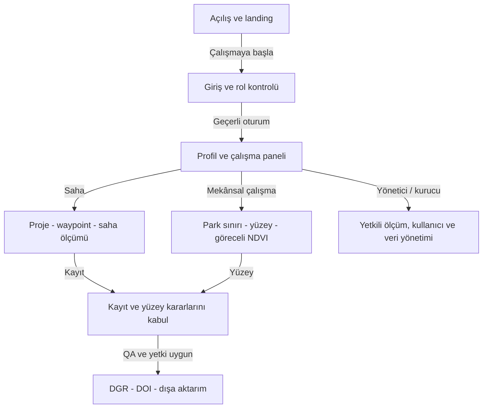

Kaynaklar: [partials/shell.html](../partials/shell.html) · [src/ui/shell-navigation-controller.js](../src/ui/shell-navigation-controller.js)

<a id="landing"></a>

## Landing, dil ve kamuya açık belgeler

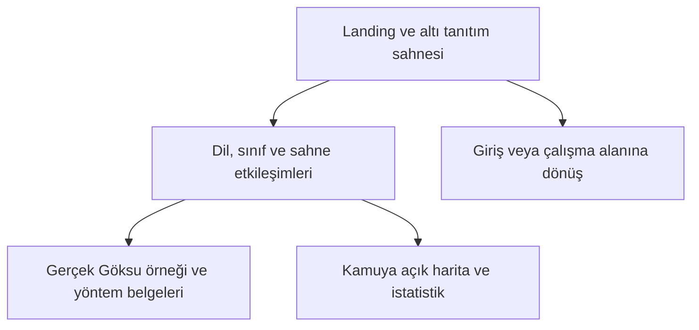

Kaynaklar: [src/ui/landing-actions.js](../src/ui/landing-actions.js) · [src/ui/landing-home-navigation.js](../src/ui/landing-home-navigation.js) · [src/config/i18n.js](../src/config/i18n.js)

<a id="auth"></a>

## Oturum, kayıt ve parola kurtarma

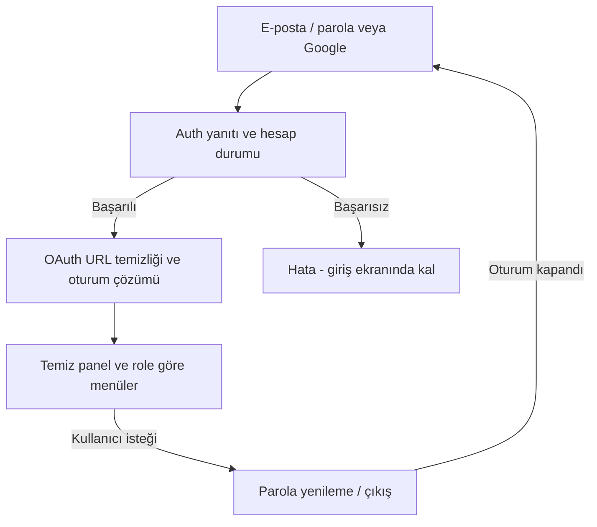

Kaynaklar: [src/services/auth.js](../src/services/auth.js) · [src/application/auth/start-authenticated-session.js](../src/application/auth/start-authenticated-session.js) · [src/application/auth/sign-out.js](../src/application/auth/sign-out.js)

<a id="profile"></a>

## Profil, kişisel ayarlar ve görünüm

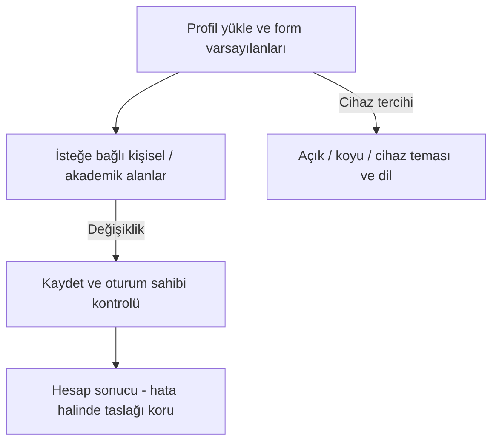

Kaynaklar: [src/services/academic-profile.js](../src/services/academic-profile.js) · [src/ui/save-academic-profile.js](../src/ui/save-academic-profile.js) · [src/ui/academic-profile-interactions.js](../src/ui/academic-profile-interactions.js)

<a id="measurement"></a>

## Çevre, DBH, boy, allometri ve ölçüm kaydı

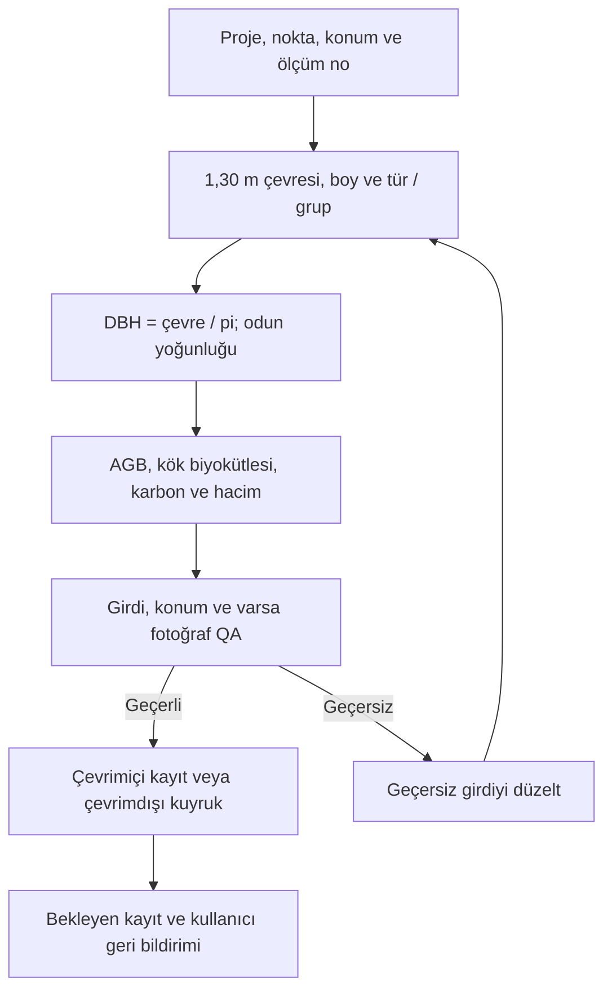

Kaynaklar: [src/application/trees/submit-measurement.js](../src/application/trees/submit-measurement.js) · [src/application/trees/persist-measurement-submission.js](../src/application/trees/persist-measurement-submission.js) · [src/domain/trees/allometry.js](../src/domain/trees/allometry.js) · [src/config/measurement-protocol-lock.js](../src/config/measurement-protocol-lock.js)

<a id="offline"></a>

## Çevrimdışı kayıt ve senkronizasyon

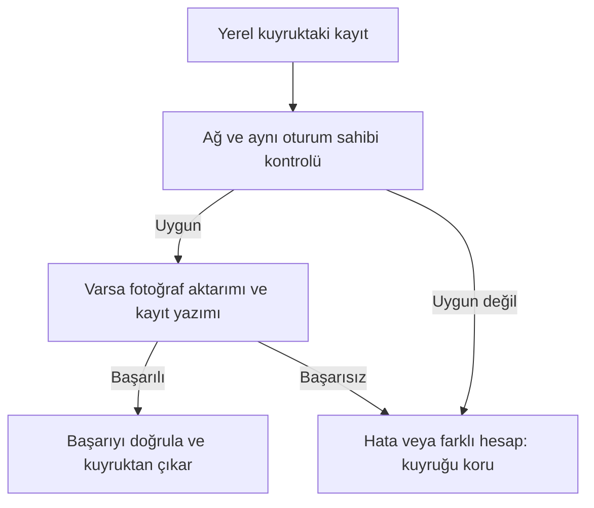

Kaynaklar: [src/application/offline/coordinate-measurement-sync.js](../src/application/offline/coordinate-measurement-sync.js) · [src/application/offline/drain-measurement-queue.js](../src/application/offline/drain-measurement-queue.js) · [src/application/offline/sync-queued-measurement.js](../src/application/offline/sync-queued-measurement.js)

<a id="projects"></a>

## Proje oluşturma ve ortak çalışma

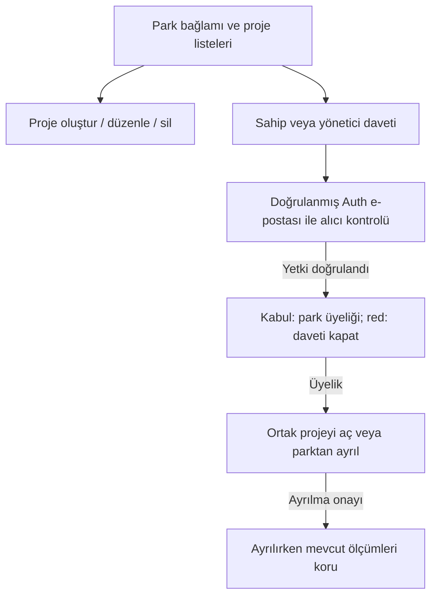

Kaynaklar: [src/application/trees/save-measurement-project.js](../src/application/trees/save-measurement-project.js) · [src/application/park-invites/manage-invites.js](../src/application/park-invites/manage-invites.js) · [src/application/park-invites/load-recipient-invites.js](../src/application/park-invites/load-recipient-invites.js)

<a id="records"></a>

## Kayıtlarım ve kayıt yaşam döngüsü

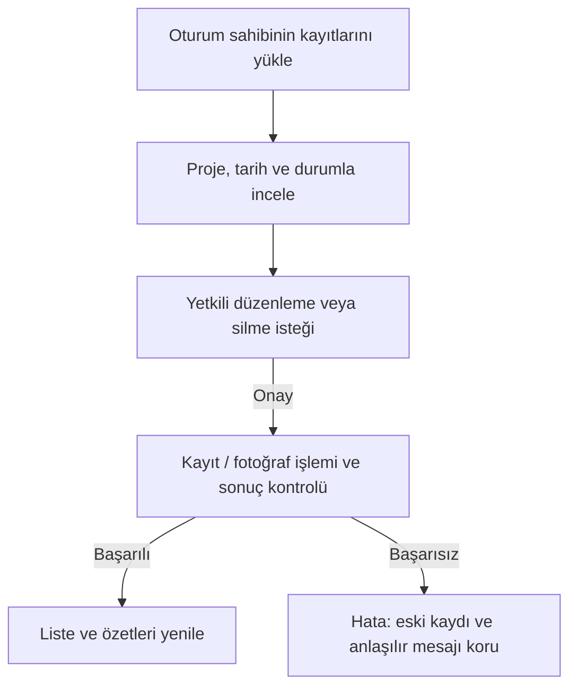

Kaynaklar: [src/ui/load-own-records.js](../src/ui/load-own-records.js) · [src/application/trees/edit-measurement-record.js](../src/application/trees/edit-measurement-record.js) · [src/application/dashboard/delete-own-record.js](../src/application/dashboard/delete-own-record.js)

<a id="waypoint"></a>

## Waypoint, CSV, grid ve navigasyon

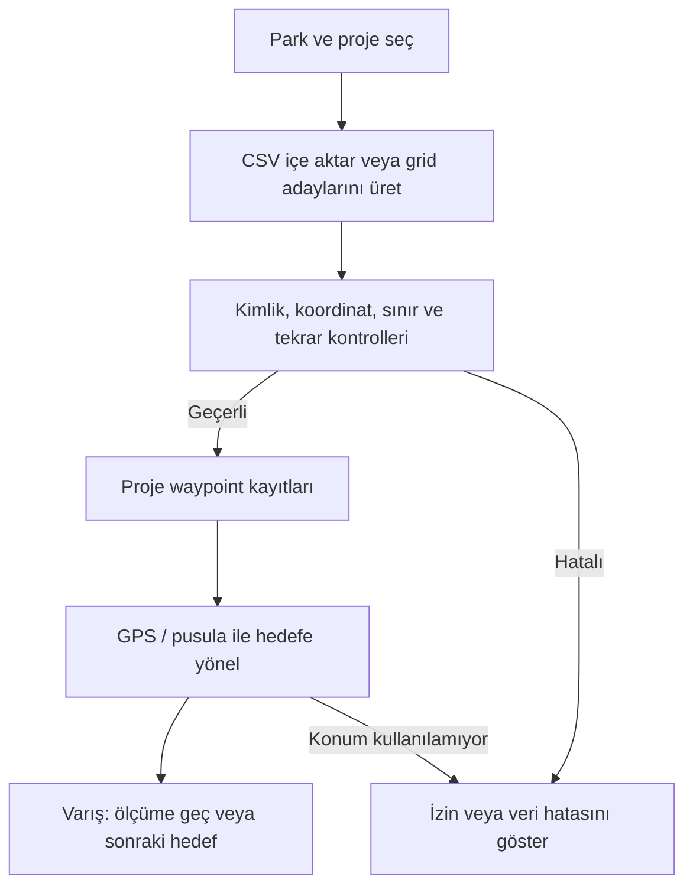

Kaynaklar: [src/application/parks/upload-waypoint-csv.js](../src/application/parks/upload-waypoint-csv.js) · [src/application/parks/create-grid-waypoints.js](../src/application/parks/create-grid-waypoints.js) · [src/application/map/arrive-at-waypoint.js](../src/application/map/arrive-at-waypoint.js)

<a id="live-map"></a>

## Canlı harita ve katmanlar

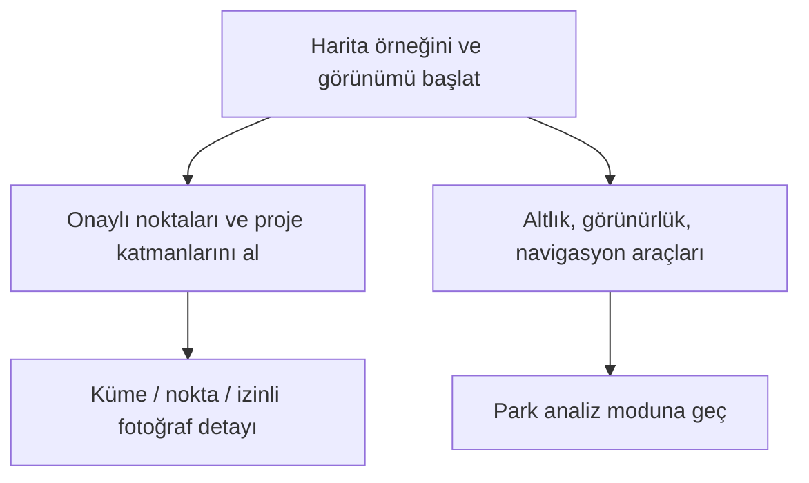

Kaynaklar: [src/application/map/load-live-measurements-map.js](../src/application/map/load-live-measurements-map.js) · [src/application/map/switch-base-map-layer.js](../src/application/map/switch-base-map-layer.js) · [src/application/map/load-approved-measurement-markers.js](../src/application/map/load-approved-measurement-markers.js)

<a id="park"></a>

## Park algılama ve sınır yönetimi

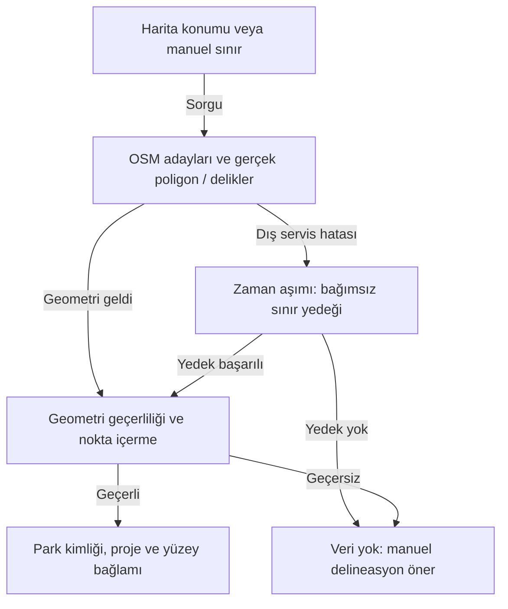

Kaynaklar: [src/application/parks/detect-park.js](../src/application/parks/detect-park.js) · [src/application/parks/find-nominatim-boundary.js](../src/application/parks/find-nominatim-boundary.js) · [src/services/park-query.js](../src/services/park-query.js)

<a id="surface"></a>

## Ham yüzey örtüsü ve kaynak durumu

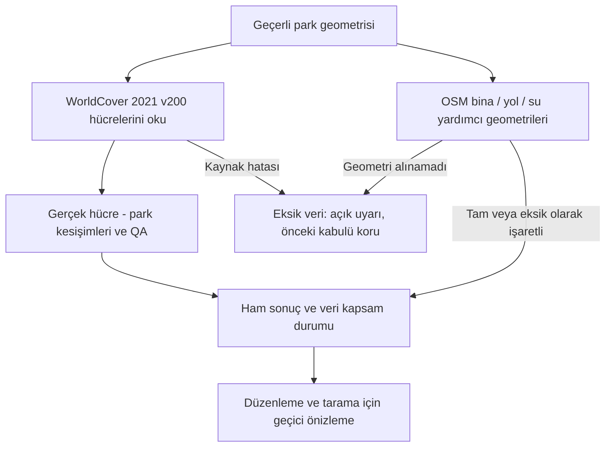

Kaynaklar: [src/contracts/surface-analysis.js](../src/contracts/surface-analysis.js) · [src/services/park-query.js](../src/services/park-query.js) · [src/application/parks/commit-park-coverage-snapshot.js](../src/application/parks/commit-park-coverage-snapshot.js)

<a id="spectral"></a>

## Sentinel-2 taraması ve göreceli NDVI

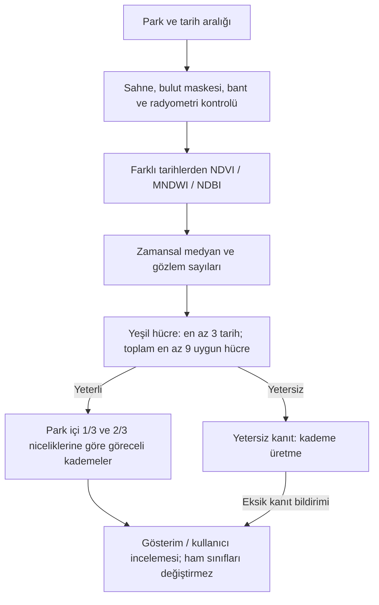

Kaynaklar: [src/application/surface/collect-sentinel-scene-observations.js](../src/application/surface/collect-sentinel-scene-observations.js) · [src/application/surface/build-sentinel-profile.js](../src/application/surface/build-sentinel-profile.js) · [src/domain/surface/classify-surface-vegetation-tiers.js](../src/domain/surface/classify-surface-vegetation-tiers.js)

<a id="editing"></a>

## Hücre, fırça, nesne ve sınır düzenleme

```mermaid
flowchart TD
  a["Düzenlenebilir analiz önizlemesi"]
  b["Hücre / fırça / nesne / çokgen / dikdörtgen / daire"]
  c["Projeksiyon, geçerli halka ve parka kırpma"]
  d["Geçici sınıf kararı ve geri alma"]
  e["Alan toplamı, kapsam ve kabul kapıları"]
  f["Kabul et ve kaydet: revizyon kontrolü"]
  g["Kabul edilmiş snapshot ve harita"]
  h["Hata: taslak veya önceki kabulü koru"]
  a --> b
  b --> c
  c -->|"Geçerli"| d
  d -->|"Çizimi bitirene kadar"| b
  d -->|"Kabul isteği"| e
  e -->|"Kapılar geçti"| f
  f -->|"Kayıt başarılı"| g
  c -->|"Geometri hatası"| h
  e -->|"Eksik kaynak"| h
  f -->|"Revizyon / ağ hatası"| h
```

Kaynaklar: [src/domain/surface/select-surface-brush-cells.js](../src/domain/surface/select-surface-brush-cells.js) · [src/domain/surface/prepare-surface-boundary.js](../src/domain/surface/prepare-surface-boundary.js) · [src/domain/surface/build-boundary-shape-ring.js](../src/domain/surface/build-boundary-shape-ring.js) · [src/application/surface/accept-surface-analysis.js](../src/application/surface/accept-surface-analysis.js)

<a id="shared-surface"></a>

## Ortak kayıtlı harita ve taze analiz

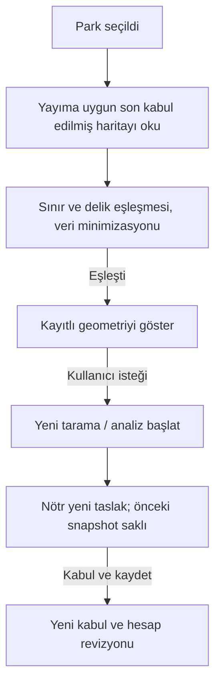

Kaynaklar: [docs/SHARED-PARK-SURFACE-2026-10-16.md](../docs/SHARED-PARK-SURFACE-2026-10-16.md) · [supabase/migrations/20261016145733_shared_park_access_and_accepted_surface.sql](../supabase/migrations/20261016145733_shared_park_access_and_accepted_surface.sql)

<a id="publication"></a>

## DGR yayın, PDF, DOI ve geri çekme

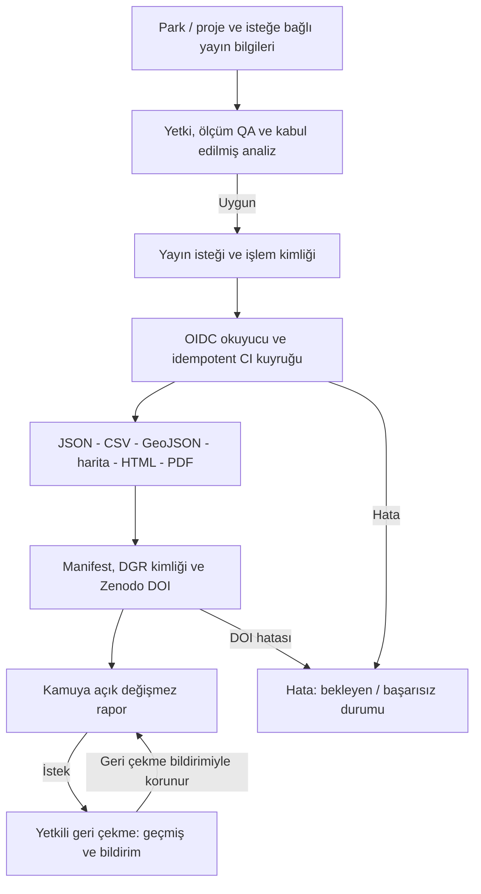

Kaynaklar: [src/application/reports/request-publication.js](../src/application/reports/request-publication.js) · [scripts/publish-queue.mjs](../scripts/publish-queue.mjs) · [scripts/register-pending-dois.mjs](../scripts/register-pending-dois.mjs) · [scripts/lib/report-retraction-workflow.mjs](../scripts/lib/report-retraction-workflow.mjs)

<a id="exports"></a>

## Dışa aktarım ve veri talepleri

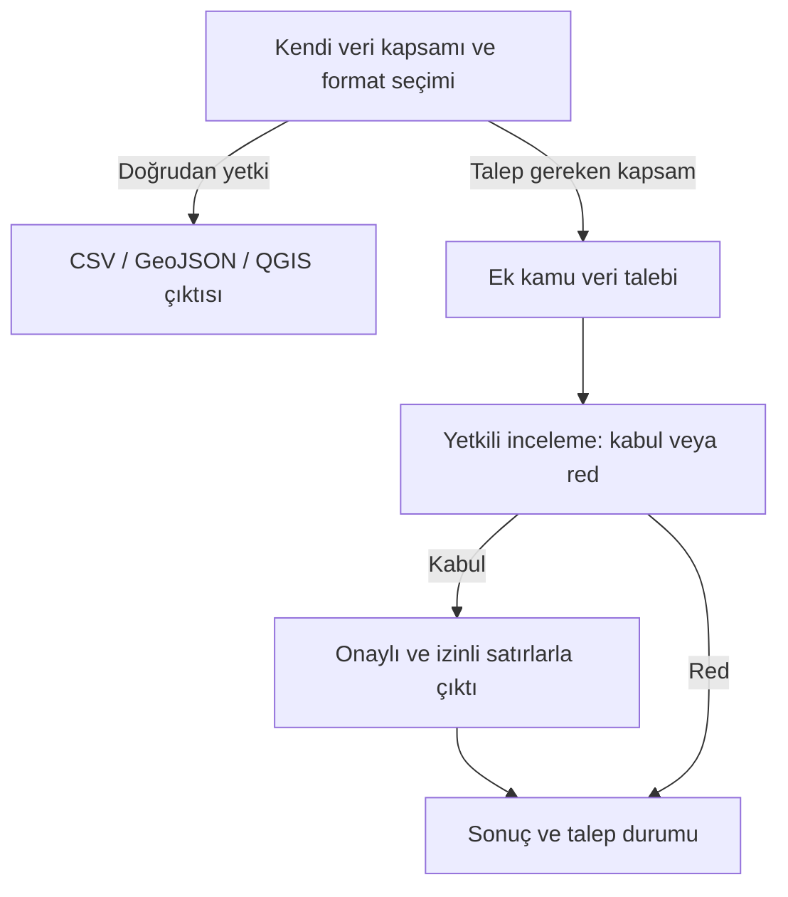

Kaynaklar: [src/application/export/download-user-measurement-export.js](../src/application/export/download-user-measurement-export.js) · [src/application/data-requests/submit-request.js](../src/application/data-requests/submit-request.js) · [src/application/data-requests/fulfill-request.js](../src/application/data-requests/fulfill-request.js)

<a id="world"></a>

## Dünya verisi, analiz ve park karşılaştırma

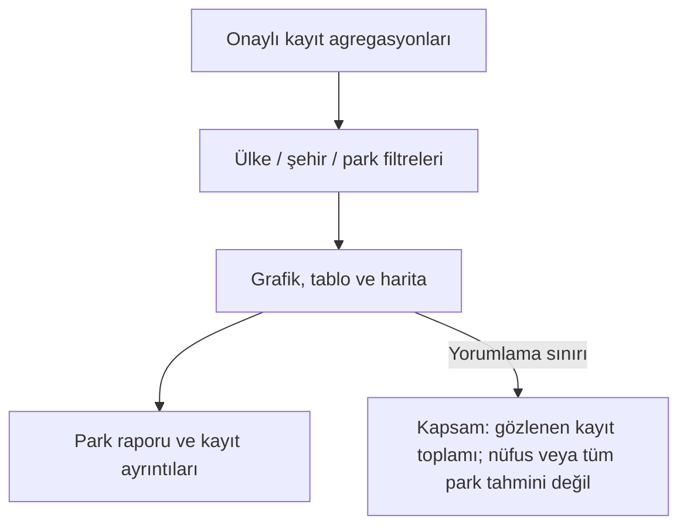

Kaynaklar: [src/application/dashboard/load-world-dashboard.js](../src/application/dashboard/load-world-dashboard.js) · [src/application/world/load-park-comparison.js](../src/application/world/load-park-comparison.js) · [src/application/world/load-park-report.js](../src/application/world/load-park-report.js)

<a id="moderation"></a>

## Ölçüm ve park kimliği yönetimi

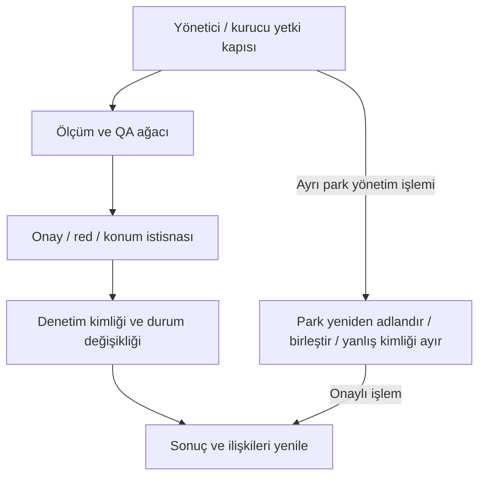

Kaynaklar: [src/application/admin/review-measurement.js](../src/application/admin/review-measurement.js) · [src/application/parks/rename-park-identity.js](../src/application/parks/rename-park-identity.js) · [src/application/parks/delete-park-identity.js](../src/application/parks/delete-park-identity.js)

<a id="users"></a>

## Kullanıcı ve yetki yönetimi

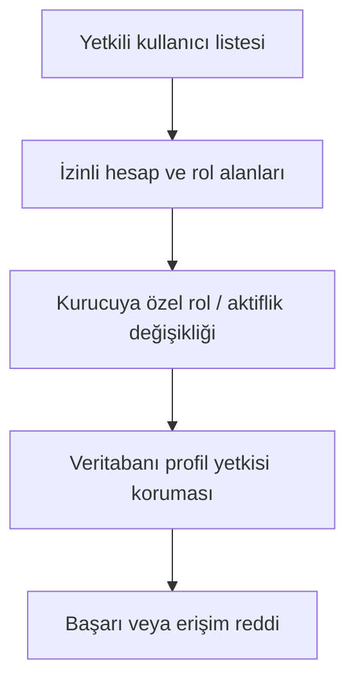

Kaynaklar: [src/application/users/load-admin-users.js](../src/application/users/load-admin-users.js) · [supabase/migrations/20261004165219_profile_privilege_guard.sql](../supabase/migrations/20261004165219_profile_privilege_guard.sql)

<a id="visitors"></a>

## Canlı varlık, ziyaretçi ve etkinlik

```mermaid
flowchart TD
  a["Oturum ve mevcut izinler"]
  b["Geçici presence / etkinlik mesajları"]
  c["Yetkili canlı liste, harita ve filtre"]
  d["Duraklat, sekme değiştir veya çıkış"]
  e["Abonelik ve zamanlayıcıları kapat"]
  a --> b
  b -->|"Rol sınırı"| c
  c --> d
  d --> e
```

Kaynaklar: [src/application/visitors/start-presence-session.js](../src/application/visitors/start-presence-session.js) · [src/application/visitors/stop-presence-session.js](../src/application/visitors/stop-presence-session.js) · [src/application/visitors/refresh-owner-view.js](../src/application/visitors/refresh-owner-view.js)

<a id="backup"></a>

## Veri dışa yedeği ve geri yükleme sınırı

```mermaid
flowchart TD
  a["Yetkili yedek isteği"]
  b["Oturum RLS kapsamındaki tablolar"]
  c["JSON ve açık eksik-kapsam listesi"]
  d["Geri yükleme dosyasını doğrula"]
  e["Onay sonrası SQL dosyası indir"]
  f["Yetkilinin ayrı manuel uygulaması"]
  g["Tam sistem / Storage / Auth kurtarması bu akışta yok"]
  a --> b
  b --> c
  c -->|"İçe alma"| d
  d --> e
  e -->|"Uygulama otomatik çalıştırmaz"| f
  c -->|"Kapsam bildirimi"| g
```

Kaynaklar: [src/application/backup/create-full-backup.js](../src/application/backup/create-full-backup.js) · [src/domain/backup/build-snapshot.js](../src/domain/backup/build-snapshot.js) · [src/application/backup/restore-backup.js](../src/application/backup/restore-backup.js)

<a id="quality"></a>

## Doğrulama araçları ve bilimsel kabul

```mermaid
flowchart TD
  a["Alan ve örneklem tasarımı"]
  b["Bağımsız referans etiketleri veya yalnız spektral kıyas"]
  c["Kapsama uygun OA, sınıf doğruluğu ve alan belirsizliği"]
  d["Karbon için ayrı Monte Carlo varsayımları"]
  e["Yorum ve açık doğrulama durumu"]
  f["Referans yok: bağımsız doğruluk iddiası yok"]
  a --> b
  b -->|"Bağımsız veri varsa"| c
  b -->|"Yalnız kaynak / spektral kıyas"| f
  c --> e
  d -->|"Ayrı belirsizlik alanı"| e
  f --> e
```

Kaynaklar: [src/domain/surface/validation-sampling.js](../src/domain/surface/validation-sampling.js) · [src/domain/surface/validation-accuracy-metrics.js](../src/domain/surface/validation-accuracy-metrics.js) · [scripts/lib/mc.mjs](../scripts/lib/mc.mjs)

<a id="delivery"></a>

## PWA, CI ve yayına çıkış

```mermaid
flowchart TD
  a["Kaynak / modül / kilit / build / sürüm kontrolleri"]
  b["Birim ve PostgreSQL sözleşme testleri"]
  c["Telefon, WebKit ve erişilebilirlik testleri"]
  d["Main ve Pages yayını"]
  e["Service Worker ve varlık sürümleri"]
  f["Hata: dağıtım veya rapor kuyruğunu durdur"]
  a --> b
  b --> c
  c -->|"Geçti"| d
  d --> e
  a -->|"Başarısız"| f
  b -->|"Başarısız"| f
  c -->|"Başarısız"| f
```

Kaynaklar: [sw.js](../sw.js) · [.github/workflows/ci.yml](../.github/workflows/ci.yml) · [scripts/check-phone.mjs](../scripts/check-phone.mjs)

## Fonksiyon düzeyi kapsam

`scripts/academic-audit.mjs`, birinci taraf JavaScript dosyalarındaki fonksiyonları başlangıç/bitiş satırlarıyla ve çağrı noktalarını ayrı CSV dosyalarıyla çıkarır. Dinamik bağımlılık enjeksiyonu ve global facade çağrıları nedeniyle bu indeks otomatik kesin çağrı grafiği değildir. Yukarıdaki diyagramlar uygulama davranışının kaynaklarla eşlenmiş işlevsel görünümüdür.
